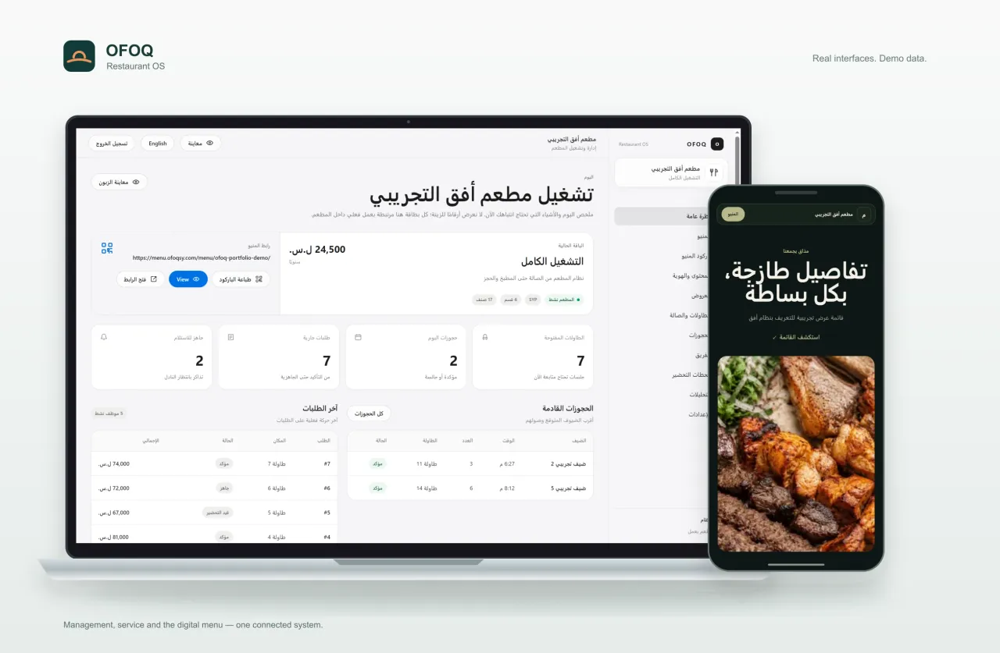
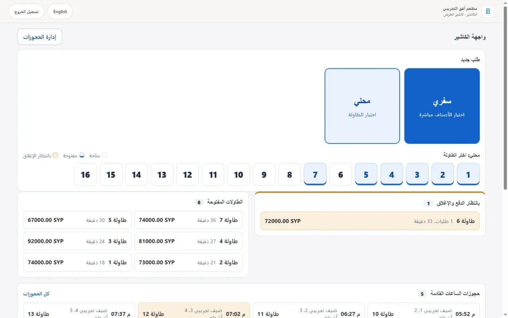
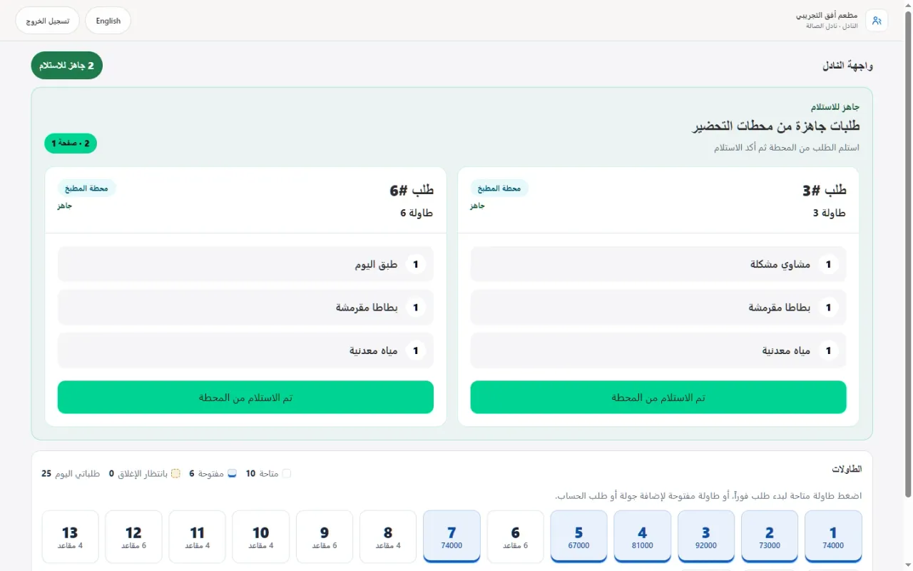
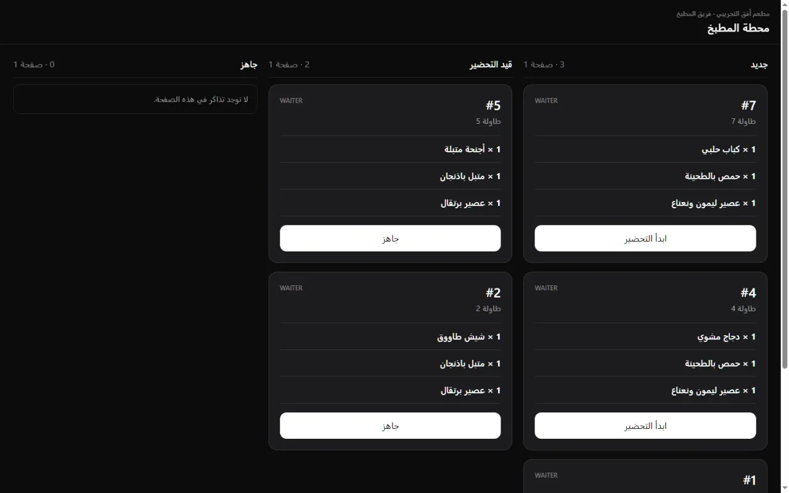
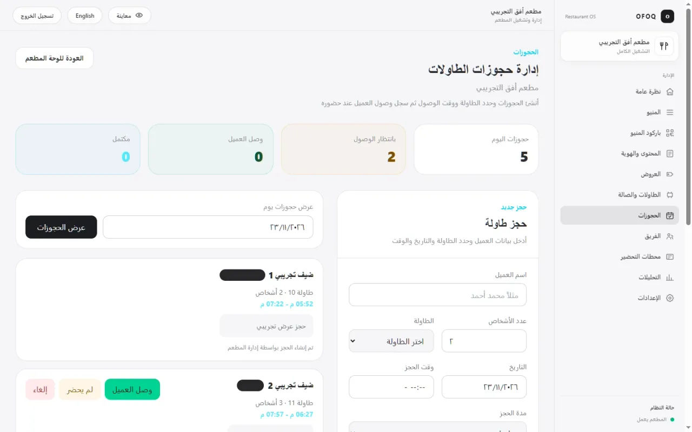

# OFOQ Restaurant OS · أفق

An operating system for restaurants, from the table to the kitchen to the bill.

OFOQ runs a restaurant's day in one system: tables, orders, waiters, cashier, prep stations, reservations, and a [digital menu](https://menu.ofoqsy.com/) guests open by QR. Seven restaurants are running on it in the current trial.

> This repo is a public write-up. The product source is private.
> Full case study: [mohammedkhankan.github.io/khankan-portfolio/en/projects/ofoq](https://mohammedkhankan.github.io/khankan-portfolio/en/projects/ofoq/)

## Shape of the system

- **4 role views:** owner, cashier, waiter, kitchen. Each sees what that job needs.
- **6 core entities:** table, session, order, ticket, bill, payment.
- **7 restaurants** in trial. 30-day free trial, then monthly or yearly plans.

## Design decisions

**A table is not a visit.** A table is a place; a session is one visit to it. Splitting the two means a table can be freed and reused right away without losing the previous bill or mixing two parties.

**The kitchen works on tickets, not orders.** Prep tickets are their own entity, so items route to different stations and are tracked separately.

**Field-test before scaling.** Running in a real restaurant shows what a dev environment can't: how fast staff type under pressure, which screens are unreadable at a busy pass, and the ways people actually use it.

## Edge cases handled

- The same payment submitted twice is recorded once.
- Two reservations can't overlap on the same table.
- A staff member's changed permissions apply to their very next action, mid-shift.
- Paying the bill doesn't cancel open prep tickets; the kitchen finishes.
- Prices are re-read on the server when an order is confirmed, never trusted from a stale screen.

## Screens

Real screens with demo data.

| Cashier and tables | Waiter |
|---|---|
|  |  |

| Kitchen stations | Reservations |
|---|---|
|  |  |

## Stack

Next.js 16 · React 19 · TypeScript · Prisma 7 · PostgreSQL · Supabase Auth · Docker · Bunny

## Next

Performance measurement under realistic load, richer reporting, and changes driven by the restaurants in the trial.

---

Built by [Mohammed Khankan](https://github.com/mohammedkhankan) · OFOQ Technical Solutions & Digitalization. For a demo: engmohammedkhankan@gmail.com
